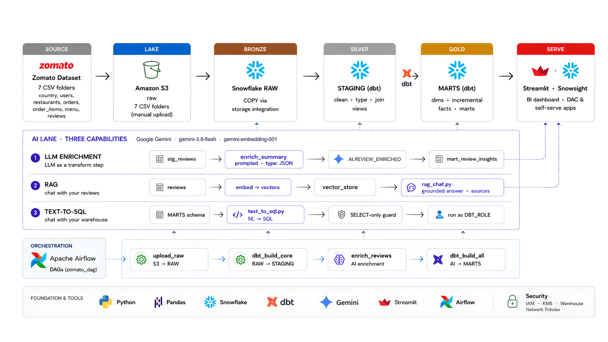
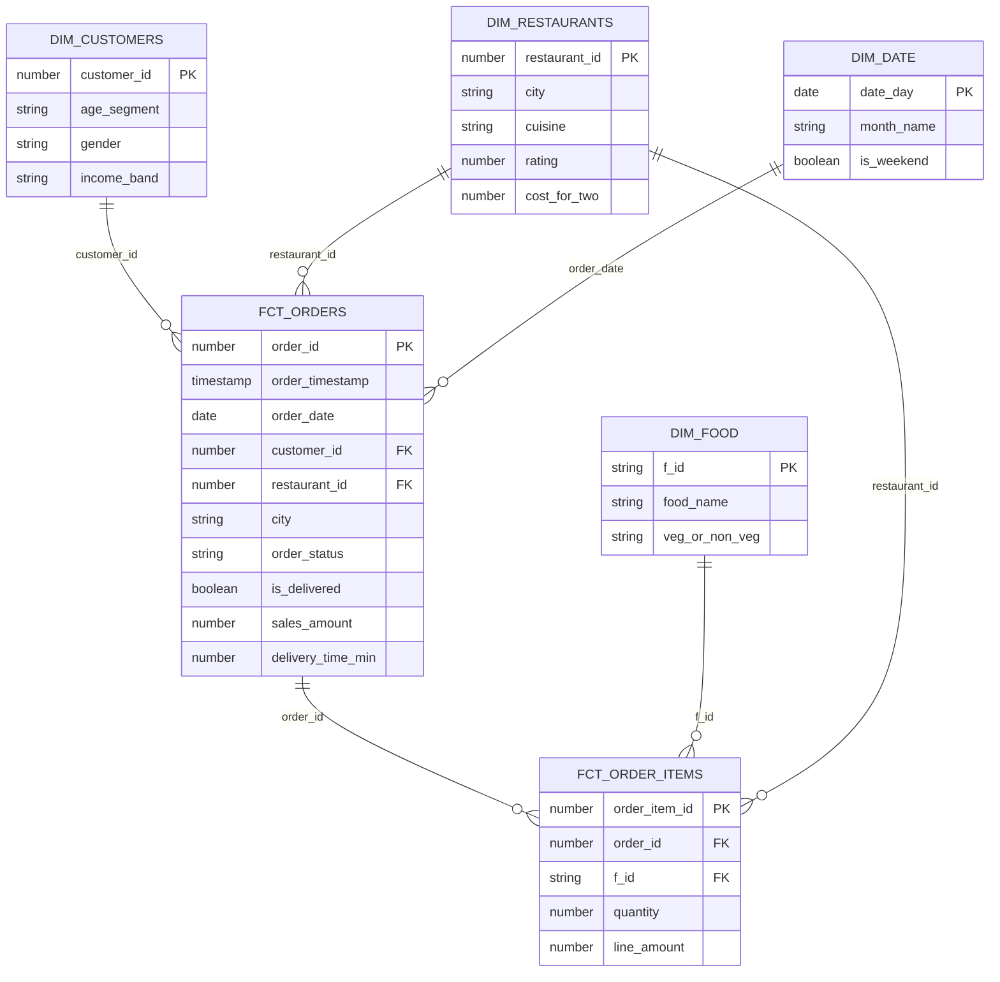
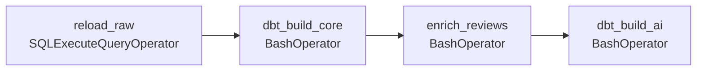

# Architecture

This document explains how the Zomato Data Pipeline is built and why. To set it up and run it, see [README.md](README.md).

## 1. Overview



The diagram below shows the same flow at the component level.

```mermaid
flowchart LR
    subgraph Source
        CSV[data/*.csv]
    end

    subgraph AWS
        S3[(S3 bucket<br/>raw/&lt;table&gt;/)]
    end

    subgraph Snowflake["Snowflake · database ZOMATO · warehouse ZOMATO_WH"]
        STAGE[[External stage<br/>ZOMATO_RAW_STAGE]]
        RAW[(RAW<br/>landing tables)]
        STG[(STAGING<br/>stg_* views)]
        MARTS[(MARTS<br/>dim / fct / mart)]
        AI[(AI<br/>review_enriched)]
    end

    subgraph Orchestration["Airflow 3 (Docker)"]
        DAG{{zomato_batch<br/>@daily}}
    end

    subgraph LLM["Google Gemini"]
        GEN[gemini-flash<br/>classification / SQL / answers]
        EMB[gemini-embedding-001]
    end

    subgraph Apps["Streamlit apps"]
        T2S[text_to_sql.py]
        RAG[rag_chat.py]
    end

    CSV -- aws s3 cp --> S3
    S3 -- storage integration<br/>ZOMATO_S3_INT --> STAGE
    STAGE -- COPY INTO --> RAW
    RAW -- dbt --> STG
    STG -- dbt --> MARTS
    RAW -- enrich_reviews.py --> GEN
    GEN --> AI
    AI -- dbt tag:ai --> MARTS

    DAG -. orchestrates .-> STAGE
    DAG -. orchestrates .-> STG
    DAG -. orchestrates .-> GEN

    T2S -- question --> GEN
    T2S -- SELECT --> MARTS
    RAG -- sample reviews --> STG
    RAG --> EMB
    RAG --> GEN
```

| Layer | Technology | Responsibility |
|---|---|---|
| Ingestion | Amazon S3 + Snowflake external stage | Store raw files; give Snowflake keyless access through a storage integration (IAM role) |
| Storage / compute | Snowflake (XS warehouse, 60s auto-suspend) | All storage and SQL compute |
| Transformation | dbt-snowflake 1.8 | Clean, type and model the data into a star schema and marts; run tests |
| Orchestration | Apache Airflow 3.0 (LocalExecutor, Docker) | Run load → transform → enrich in order, every day |
| AI enrichment | Google Gemini (structured JSON output) | Turn free-text reviews into sentiment, topic and key issue |
| Consumption | Streamlit | Text-to-SQL over the marts; RAG chat over the reviews |

---

## 2. Data layers (medallion)

```
S3 raw/ ──► RAW ──► STAGING ──► MARTS
                         ▲         ▲
             AI.review_enriched ───┘ (via tag:ai)
```

| Schema | Created by | Materialization | Purpose |
|---|---|---|---|
| `RAW` | `snowflake/04_raw_table.sql` + `COPY INTO` | tables | Loaded exactly as in the files. The Kaggle-style CSVs (restaurants, users, food, menu) arrive with all columns as `STRING` and an `_idx` index column. The generated files (orders, order_items, reviews) arrive already typed. |
| `STAGING` | dbt `models/staging` | **views** | One model per source: renames columns, casts with `try_to_*`, filters bad rows, standardizes city names. No business logic. |
| `MARTS` | dbt `models/marts` | **tables** (facts are incremental) | Star schema plus pre-aggregated business marts |
| `AI` | `ai/enrich_reviews.py` | table | LLM output, one row per review. Read by dbt as the `ai` source. |
| `SNAPSHOTS` | dbt (reserved) | snapshot | For SCD history. No snapshots defined yet. |
| `BRONZE` | reserved | — | For a future Spark/Iceberg ingestion path |

The custom macro `macros/generate_schema_name.sql` makes `+schema: staging` land in `STAGING`. Without it, dbt would name the schema `STAGING_STAGING`.

### Cleaning rules in staging

- **City**: `trim(coalesce(regexp_substr(city, '[^,]+$'), city))` turns `"Ameerpet,Hyderabad"` into `Hyderabad`. The same rule runs on restaurants and orders, so the two can be joined by city.
- **Restaurant rating**: `'--'` becomes `NULL`. `rating_count` (`"50+ ratings"`) and `cost` (`"₹ 200"`) are reduced to their numbers.
- **Orders**: `is_delivered = (order_status = 'Delivered')` is computed once and reused by every mart.
- **Reviews**: rows with a null `comment` are dropped. City comes from `stg_restaurants`.

---

## 3. Data model (MARTS)



### Facts (incremental)

`fct_orders` and `fct_order_items` use `materialized='incremental'`, `incremental_strategy='merge'` and `on_schema_change='append_new_columns'`. Each run selects only rows newer than `max(order_timestamp)` already in the table, and merges on the unique key. Daily runs therefore process just the new orders. Use `--full-refresh` to rebuild a fact from scratch.

### Marts

| Model | Grain | Key metrics |
|---|---|---|
| `mart_daily_city_revenue` | date × city | orders, delivered_orders, cancel_rate, **GMV** (delivered revenue only), AOV |
| `mart_restaurant_performance` | restaurant | orders, revenue, avg_customer_rating, avg_delivery_min |
| `mart_delivery_sla` | city × order hour | delivered_orders, p50 and p90 delivery minutes |
| `mart_review_insights` *(tag: ai)* | city × topic × sentiment | review count, avg sentiment score, avg star rating, flagged issues |

`dim_date` is a generated date spine from 2024-01-01 to 2026-12-31. `dim_customers` adds an `age_segment` (Gen Z / Millennials / Gen X / Boomers / Unknown).

---

## 4. Orchestration



DAG `zomato_batch`: `@daily`, `catchup=False`, tags `zomato, dbt, snowflake`.

| Task | Command | Notes |
|---|---|---|
| `reload_raw` | 7 × `COPY INTO ZOMATO.RAW.<t> FROM @ZOMATO_RAW_STAGE/<t>/` on `snowflake_default` | Idempotent: Snowflake keeps load metadata and skips files it has already loaded. The dimension-like tables use `ON_ERROR='CONTINUE'`. Orders, order_items and reviews fail the whole load on any error. |
| `dbt_build_core` | `dbt build --exclude tag:ai` | Runs models and tests in dependency order. If a test fails, the run stops before enrichment. |
| `enrich_reviews` | `python /opt/airflow/ai/enrich_reviews.py` | Processes only reviews not yet in `AI.REVIEW_ENRICHED`, at most `SAMPLE_N` per run |
| `dbt_build_ai` | `dbt build --select tag:ai` | Rebuilds `mart_review_insights` |

**Why the AI models are a separate step.** The AI mart depends on `AI.review_enriched`, which a Python script writes, not dbt. Splitting the build with the `ai` tag means:

1. The core marts are still built if the LLM call fails or is rate-limited.
2. The AI mart always reads the latest enrichment results.

### Runtime (Docker Compose)

```
┌──────────────┐   ┌────────────┐   ┌───────────┐   ┌───────────────┐
│ postgres:15  │◄──│ api-server │   │ scheduler │   │ dag-processor │
│ metadata DB  │   │ :8080 (UI) │   │           │   │ parses DAGs   │
└──────────────┘   └─────▲──────┘   └─────┬─────┘   └───────────────┘
                         │ Execution API  │ LocalExecutor runs tasks
                         └────────────────┘
          airflow-init: db migrate + create admin user (runs once)
```

- **Image:** `apache/airflow:3.0.3` plus the Snowflake and FAB providers. dbt is installed in its **own virtualenv** (`/opt/airflow/dbt_venv`) so its dependencies never clash with Airflow's.
- **Connection:** `snowflake_default` is defined by `AIRFLOW_CONN_SNOWFLAKE_DEFAULT` (role `DBT_ROLE`, warehouse `ZOMATO_WH`).
- **Airflow 3 specifics:** `api-server` replaces `webserver`; DAG parsing runs as a separate `dag-processor`; tasks reach the Execution API by service name (`http://apiserver:8080/execution/`).
- **Mounts:** `dags/`, `logs/`, the dbt project → `/opt/airflow/dbt/zomato`, and `ai/` → `/opt/airflow/ai`.

---

## 5. AI layer

### 5.1 Review enrichment (`ai/enrich_reviews.py`)

```
RAW.REVIEWS ──(not yet enriched, LIMIT SAMPLE_N)──► Gemini (temperature 0,
JSON schema = ReviewLabels) ──► AI.REVIEW_ENRICHED (executemany, one commit)
```

- **Structured output:** a Pydantic `ReviewLabels` schema is passed as `response_schema`. The model can only return `sentiment_label ∈ {positive, negative, neutral}`, `sentiment_score ∈ [-1, 1]`, a `topic` from a fixed list (food quality, delivery, pricing, service, packaging, other) and an optional `key_issue`.
- **Incremental and idempotent:** `WHERE REVIEW_ID NOT IN (SELECT REVIEW_ID FROM AI.REVIEW_ENRICHED)`. Re-running never labels the same review twice.
- **Resilience:** exponential backoff on 429/503, then fallback to the models in `GEMINI_FALLBACKS`. A 1 s pause between calls stays under free-tier rate limits. If one review fails, the error is logged and the batch continues.
- **Lineage:** each row records the `model` that produced it and `enriched_at`.

### 5.2 Text-to-SQL (`ai/text_to_sql.py`)

1. The prompt includes a hand-written description of the MARTS schema, so the model writes SQL only against tables that exist.
2. Gemini returns `{"sql": "..."}` (structured output, temperature 0).
3. **Guardrails** before anything runs: the query must start with `SELECT`/`WITH`, contain no `;`, and none of the whole words `drop, delete, update, insert, create, grant, copy, …`.
4. Runs with role `DBT_ROLE` against schema `MARTS`. Results are shown in a table; two-column numeric results are also charted.

> Defense in depth: for production, run this app under a separate **read-only role** that has only `SELECT` on `MARTS`, instead of `DBT_ROLE`.

### 5.3 RAG over reviews (`ai/rag_chat.py`)

1. **Index:** sample 500 reviews from `STAGING.STG_REVIEWS` → embed with `gemini-embedding-001` (`RETRIEVAL_DOCUMENT`, batches of 100) → cache in a parquet file named after the model.
2. **Retrieve:** embed the question (`RETRIEVAL_QUERY`) → cosine similarity in NumPy → top 5 reviews.
3. **Generate:** Gemini answers *only* from the retrieved reviews (temperature 0.2) and shows which reviews it used.

The index is small and lives in memory, so it needs no vector database. To scale up, replace it with Snowflake `VECTOR` columns and `VECTOR_COSINE_SIMILARITY`, or Cortex Search.

---

## 6. Security

| Concern | Current approach | Recommendation |
|---|---|---|
| S3 access | Storage integration with an IAM role (no AWS keys stored in Snowflake) | Keep it; limit `STORAGE_ALLOWED_LOCATIONS` to the `raw/` prefix |
| Snowflake credentials | `.env` files and `profiles.yml` | Keep out of git; use key-pair auth or a secrets backend in production |
| Least privilege | One `DBT_ROLE` with `ALL` on the database | Use separate roles for loading, transforming and read-only BI/AI access |
| Airflow | `admin/admin`, default JWT secret, empty Fernet key | Fine for local use only; set real secrets before deploying anywhere |
| PII | `RAW.users` contains email and password columns | Staging already drops `password`; consider masking policies on `email` |
| LLM-generated SQL | Keyword and single-statement guard | Add a read-only role and a statement timeout on the warehouse |

---

## 7. Scaling and next steps

- **Near-real-time ingestion:** `05_copty_into.sql` already defines an `AUTO_INGEST` Snowpipe for `orders`. Wire its SQS ARN to S3 event notifications and drop `orders` from `reload_raw`.
- **Data quality:** add `unique` / `not_null` / `relationships` tests in `_staging.yml` / `_marts.yml`, and source freshness checks.
- **History:** add dbt snapshots (SCD2) for restaurants (rating and cost change over time) in `SNAPSHOTS`.
- **Lakehouse path:** the `BRONZE` schema is reserved for Iceberg tables written by Spark, which would become an alternative dbt source.
- **AI cost control:** raise `SAMPLE_N` slowly, or move to Gemini batch mode or Snowflake Cortex `AI_CLASSIFY` / `AI_SENTIMENT` to keep enrichment inside the warehouse.
