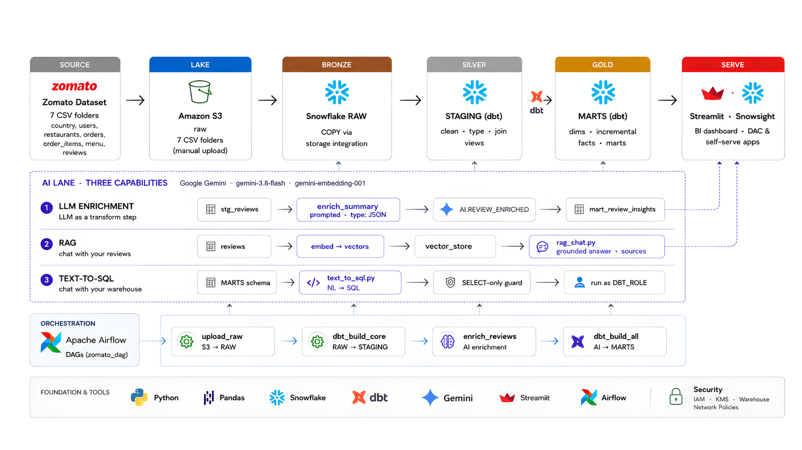

# Zomato Data Pipeline

An end-to-end batch pipeline for food-delivery data. It runs:

**CSV files → Amazon S3 → Snowflake (RAW) → dbt (STAGING → MARTS) → LLM review enrichment (Gemini) → analytics + AI apps (Streamlit)**



Airflow 3 runs the pipeline every day. dbt builds a star schema and business marts. A Gemini model labels each customer review with a sentiment, a topic and a key issue. Two Streamlit apps let you ask questions about the data in plain English: one turns questions into SQL, the other answers from the reviews (RAG).

See [ARCHITECTURE.md](ARCHITECTURE.md) for the design: layers, data flow, the DAG and the data model.

---

## Repository layout

```
ZOMATO-DATA-PIPELINE/
├── data/                     # Source CSVs (restaurant, users, food, menu, orders, reviews)
├── snowflake/                # One-time Snowflake setup scripts (run in order 01 → 05)
│   ├── 01_setup.sql              # warehouse, database, schemas, DBT_ROLE
│   ├── 02_storage_integration.sql# S3 storage integration (IAM role trust)
│   ├── 03_stage_and_formats.sql  # CSV file format + external stage on s3://…/raw/
│   ├── 04_raw_table.sql          # RAW landing tables
│   └── 05_copty_into.sql         # first manual load + optional Snowpipe
├── Zomato/                   # dbt project (profile: Zomato)
│   ├── models/staging/           # stg_* views: cleaned + typed
│   ├── models/marts/             # dim_*, fct_*, mart_* tables
│   ├── macros/generate_schema_name.sql
│   └── profiles.yml              # Snowflake connection for dbt
├── airflow/                  # Local Airflow 3 on Docker
│   ├── Dockerfile                # Airflow 3.0.3 + snowflake/fab providers + dbt venv
│   ├── docker-compose.yaml       # postgres, api-server, scheduler, dag-processor
│   ├── .env                      # credentials (not committed)
│   └── dags/zomato_batch.py      # the daily DAG
└── ai/                       # LLM layer (Google Gemini)
    ├── enrich_reviews.py         # labels reviews → ZOMATO.AI.REVIEW_ENRICHED
    ├── text_to_sql.py            # Streamlit: question → SQL → results
    ├── rag_chat.py               # Streamlit: question answered from the reviews (RAG)
    └── .env                      # credentials (not committed)
```

---

## Prerequisites

| Tool | Used for |
|---|---|
| Snowflake account (ACCOUNTADMIN for setup) | Warehouse |
| AWS account + S3 bucket + AWS CLI | Raw file landing zone |
| Docker Desktop | Running Airflow locally |
| Python 3.10+ | dbt and the AI scripts, if run outside Docker |
| Google Gemini API key | Review enrichment, text-to-SQL, RAG |

---

## 1. Configure credentials

Secrets are git-ignored. Each one has a committed template you copy and fill in:

```bash
cp airflow/.env.example       airflow/.env
cp ai/.env.example            ai/.env
cp Zomato/profiles.example.yml Zomato/profiles.yml
```

**`airflow/.env`** (read by docker-compose):

```env
SNOWFLAKE_ACCOUNT=<org-account>        # e.g. abc12345.us-east-1
SNOWFLAKE_USER=<user>
SNOWFLAKE_PASSWORD=<password>
GEMINI_API_KEY=<key>
SAMPLE_N=5                             # reviews enriched per run
```

**`ai/.env`** (read by the Python scripts through python-dotenv):

```env
SNOWFLAKE_ACCOUNT=<org-account>
SNOWFLAKE_USER=<user>
SNOWFLAKE_PASSWORD=<password>
SNOWFLAKE_WAREHOUSE=ZOMATO_WH
SNOWFLAKE_DATABASE=ZOMATO
SNOWFLAKE_SCHEMA=RAW
GEMINI_API_KEY=<key>
# Optional overrides
# GEMINI_MODEL=gemini-3.8-flash
# GEMINI_FALLBACKS=gemini-3.8-flash-lite
# GEMINI_EMBEDDING_MODEL=gemini-embedding-001
```

**`Zomato/profiles.yml`**: the template reads `SNOWFLAKE_ACCOUNT/USER/PASSWORD` from environment variables. Docker-compose already sets these inside Airflow. To run dbt on your own machine, export them in your shell first. Inside Airflow, dbt reads this file through `--profiles-dir`.

> The source CSVs in `data/` are git-ignored because `orders.csv` is 1.3 GB, and GitHub rejects files over 100 MB. Put your own copies of the CSVs in `data/` before step 2.

---

## 2. Upload the raw files to S3

The Snowflake stage points at `s3://<bucket>/raw/` and expects **one folder per table**:

```bash
BUCKET=s3://<YOUR_BUCKET>       # replace with your bucket
aws s3 cp data/restaurant.csv  $BUCKET/raw/restaurants/
aws s3 cp data/users.csv       $BUCKET/raw/users/
aws s3 cp data/food.csv        $BUCKET/raw/food/
aws s3 cp data/menu.csv        $BUCKET/raw/menu/
aws s3 cp data/orders.csv      $BUCKET/raw/orders/
aws s3 cp data/reviews.csv     $BUCKET/raw/reviews/
aws s3 cp <order_items.csv>    $BUCKET/raw/order_items/   # generated file, see note below
```

> `order_items` has a RAW table and a staging model, but no CSV in `data/` yet. Produce it alongside the generated `orders.csv`/`reviews.csv` before running the pipeline. Otherwise its `COPY` loads nothing and the `fct_order_items` table stays empty.

---

## 3. One-time Snowflake setup

Run the scripts **in order** in a Snowflake worksheet as `ACCOUNTADMIN`:

1. **`01_setup.sql`** creates warehouse `ZOMATO_WH` (XS, auto-suspends after 60s), database `ZOMATO`, schemas `RAW / STAGING / MARTS / SNAPSHOTS / AI / BRONZE`, and `DBT_ROLE`. Change `my_user` to your Snowflake username first.
2. **`02_storage_integration.sql`** creates `ZOMATO_S3_INT`. Set `STORAGE_AWS_ROLE_ARN` and `STORAGE_ALLOWED_LOCATIONS` to your own IAM role and bucket. Then copy `STORAGE_AWS_IAM_USER_ARN` and `STORAGE_AWS_EXTERNAL_ID` from the `DESC INTEGRATION` output into the IAM role's trust policy.
3. **`03_stage_and_formats.sql`** creates the CSV file format and the external stage. The closing `LIST @…` should show your uploaded files.
4. **`04_raw_table.sql`** creates the seven RAW tables.
5. **`05_copty_into.sql`** *(optional)* loads the data by hand once and prints row counts, so you can check RAW before turning on Airflow. It also creates an optional auto-ingest Snowpipe for `orders`.

---

## 4. Run the pipeline with Airflow (recommended)

```bash
cd airflow
docker compose build
docker compose up -d
```

- UI: <http://localhost:8080>. Log in with **admin / admin**.
- The `snowflake_default` connection comes from the `AIRFLOW_CONN_SNOWFLAKE_DEFAULT` env var, so nothing needs to be set up in the UI.
- Volumes mount `../Zomato` → `/opt/airflow/dbt/zomato` and `../ai` → `/opt/airflow/ai`.

Turn on the **`zomato_batch`** DAG and click **Trigger**. It runs daily (`@daily`, no catchup):

```
reload_raw  →  dbt_build_core  →  enrich_reviews  →  dbt_build_ai
```

| Task | What it does |
|---|---|
| `reload_raw` | `COPY INTO` all seven RAW tables from the S3 stage. Snowflake skips files it has already loaded. |
| `dbt_build_core` | `dbt build --exclude tag:ai` runs and tests the staging, dim, fct and mart models |
| `enrich_reviews` | Labels up to `SAMPLE_N` new reviews with Gemini → `ZOMATO.AI.REVIEW_ENRICHED` |
| `dbt_build_ai` | `dbt build --select tag:ai` builds `mart_review_insights` |

Stop the stack with `docker compose down`. Add `-v` to also delete the Airflow metadata DB.


---

## 5. Run the steps by hand (without Airflow)

Handy for development. From the repo root:

```bash
python -m venv .venv
# Windows: .venv\Scripts\activate    macOS/Linux: source .venv/bin/activate
pip install "dbt-snowflake==1.8.*" google-genai "snowflake-connector-python[pandas]" \
            pydantic python-dotenv streamlit pandas numpy pyarrow
```

```bash
# 1) Load RAW: run snowflake/05_copty_into.sql in Snowflake

# 2) Core dbt models
cd Zomato
dbt debug   --profiles-dir .              # check the connection
dbt build   --exclude tag:ai --profiles-dir .

# 3) LLM enrichment
cd ../ai
python enrich_reviews.py                  # SAMPLE_N reviews per run (default 5)

# 4) AI mart
cd ../Zomato
dbt build --select tag:ai --profiles-dir .
```

Useful dbt commands:

```bash
dbt run  --select staging          --profiles-dir .
dbt run  --select fct_orders+      --profiles-dir .     # a model and everything after it
dbt run  --full-refresh -s fct_orders --profiles-dir .  # rebuild an incremental model from scratch
dbt docs generate --profiles-dir . && dbt docs serve --profiles-dir .
```

---

## 6. Run the AI apps

Both apps read `ai/.env`. Run them from the `ai/` folder:

```bash
cd ai
streamlit run text_to_sql.py      # ask questions about orders, revenue and delivery SLA → SQL on MARTS
streamlit run rag_chat.py         # ask questions answered from customer reviews (RAG)
```

- **text_to_sql.py**: Gemini writes one `SELECT` against `ZOMATO.MARTS`. A guard blocks anything that isn't a single read-only `SELECT`/`WITH`, then Snowflake runs it. Two-column numeric results are also shown as a bar chart.
- **rag_chat.py**: samples 500 reviews from `STAGING.STG_REVIEWS`, embeds them with `gemini-embedding-001`, and caches them in `review_embeddings_<model>.parquet`. It finds the top 5 reviews by cosine similarity and answers only from those. Delete the parquet file to pull a fresh sample.

---

## Snowflake objects produced

| Schema | Objects |
|---|---|
| `RAW` | `restaurants, users, food, menu, orders, order_items, reviews` |
| `STAGING` (views) | `stg_restaurants, stg_users, stg_food, stg_menu, stg_orders, stg_order_items, stg_reviews` |
| `MARTS` (tables) | `dim_customers, dim_restaurants, dim_food, dim_date, fct_orders`*, `fct_order_items`*, `mart_daily_city_revenue, mart_restaurant_performance, mart_delivery_sla, mart_review_insights` |
| `AI` | `review_enriched` |

\* incremental (merge on `order_id` / `order_item_id`)

---

## Troubleshooting

| Symptom | Fix |
|---|---|
| Tasks fail with *"state mismatch … failed"* | `AIRFLOW__CORE__EXECUTION_API_SERVER_URL` must point at `http://apiserver:8080/execution/` (already set). |
| `COPY` loads 0 rows | Run `LIST @ZOMATO.RAW.ZOMATO_RAW_STAGE;` and check the folder names match the table names. Snowflake also skips files it has already loaded. |
| `Access denied` on the stage | The IAM trust policy is missing the external ID / IAM user from `DESC INTEGRATION ZOMATO_S3_INT`. |
| Models land in `STAGING_STAGING` | The `generate_schema_name` macro must be in `Zomato/macros/`. It's what makes models land in `STAGING` / `MARTS` as written. |
| Gemini 429 / 503 | The scripts already retry with backoff and fall back to `GEMINI_FALLBACKS`. Lower `SAMPLE_N` or wait a little. |
| `enrich_reviews` fails with `No module named 'google'` | The image is out of date. Rebuild it: `docker compose build --no-cache`. |
